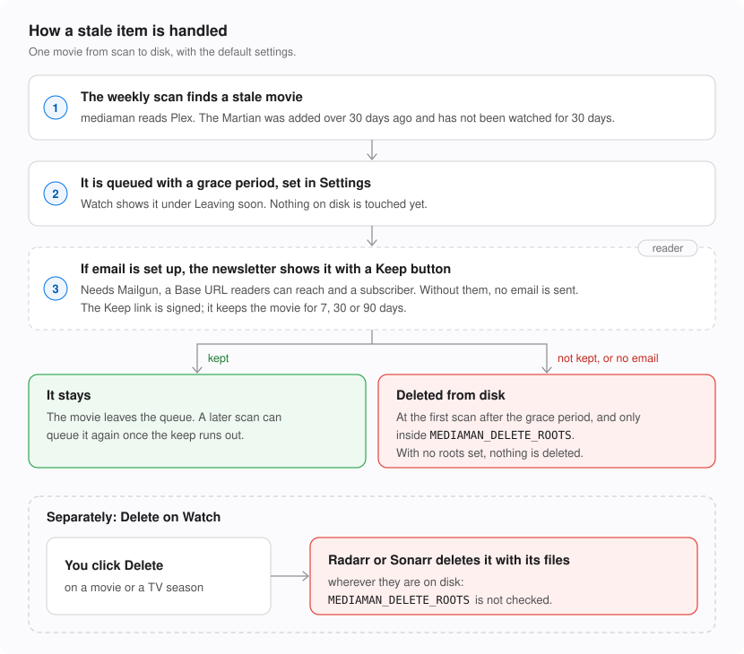

# mediaman

[](https://github.com/rossetv/mediaman/actions/workflows/ci.yml)
[](https://hub.docker.com/r/rossetv/mediaman)

mediaman keeps a self-hosted Plex library from filling up. It queues old, unwatched items for deletion, emails a newsletter where readers can keep them, and drives Sonarr, Radarr and NZBGet from a web UI.



## Run it

```bash
openssl rand -hex 32 > mediaman.key   # keep it: encrypted settings need the same key

docker run -d --name mediaman \
  -p 8282:8282 \
  -e MEDIAMAN_SECRET_KEY="$(cat mediaman.key)" \
  -v mediaman-data:/data \
  -v /path/to/your/media:/media \
  rossetv/mediaman

docker exec -it mediaman mediaman-create-user   # asks for the first admin; needs a terminal
```

Mount your media at the path Plex uses for it (`/media` here), writable by uid 1000.

The session cookie is always `Secure`: before you log in, use HTTPS or add `-e MEDIAMAN_FORCE_SECURE_COOKIES=false` for plain `http://`.

Open `http://<host>:8282`, log in and add your services under Settings:


Scheduled deletion stays off until you set `MEDIAMAN_DELETE_ROOTS`. Press Scan now on the Dashboard, check what it lists under Scheduled for deletion, then recreate the container with your library folders, separated by `:`. The next scan deletes everything past its grace period.

```bash
docker rm -f mediaman
docker run -d --name mediaman \
  -p 8282:8282 \
  -e MEDIAMAN_SECRET_KEY="$(cat mediaman.key)" \
  -e MEDIAMAN_DELETE_ROOTS=/media/movies:/media/tv \
  -v mediaman-data:/data \
  -v /path/to/your/media:/media \
  rossetv/mediaman
```

`/`, `/media`, `/data`, `/mnt`, `/srv`, `/home` and the system directories are refused as roots, and one refused root stops every scheduled deletion.

To upgrade, `docker pull rossetv/mediaman` and rerun the two commands above as you run them now: same key, same `/data` volume, your roots and flags. A database last opened by a build from before 13 May 2026 is not supported.

`/healthz` answers 200 while the process runs; `/readyz` answers 503 until the scheduler starts, or if the key does not match the database.

## Environment

| Variable | Default | What it does |
|---|---|---|
| `MEDIAMAN_SECRET_KEY` | required | 64+ hex characters or 43+ URL-safe base64; a weak key stops startup |
| `MEDIAMAN_DELETE_ROOTS` | unset: no scheduled deletion | Library folders scheduled deletion may delete from, as seen inside the container, separated by `:` |
| `MEDIAMAN_FORCE_SECURE_COOKIES` | unset: always `Secure` | `false` allows login over plain HTTP and also turns HSTS off |

[`.env.example`](.env.example) explains `MEDIAMAN_PORT`, `MEDIAMAN_BIND_HOST`, `MEDIAMAN_DATA_DIR` and `MEDIAMAN_TRUSTED_PROXIES`. Rarely needed: `MEDIAMAN_ALLOWED_HOSTS`, `MEDIAMAN_HSTS_ENABLED`, `MEDIAMAN_MAX_REQUEST_BYTES`, `MEDIAMAN_MEDIA_PATH`, `MEDIAMAN_STRICT_EGRESS`, `MEDIAMAN_CLOUDFLARE_PROXIES`, `MEDIAMAN_FINGERPRINT_MODE`, `MEDIAMAN_REAUTH_WINDOW_SECONDS`, `MEDIAMAN_HSTS_PRELOAD`, `MEDIAMAN_WORKERS`, `MEDIAMAN_EAGER_APP`.

## Development

Python 3.12; see [CONTRIBUTING.md](CONTRIBUTING.md).

```bash
python3.12 -m venv .venv && source .venv/bin/activate
pip install -e ".[dev]" "bandit[toml]" pip-audit
make check

mkdir -p data
[ -f mediaman.key ] || openssl rand -hex 32 > mediaman.key   # reuse one key
export MEDIAMAN_SECRET_KEY="$(cat mediaman.key)" MEDIAMAN_DATA_DIR=./data MEDIAMAN_FORCE_SECURE_COOKIES=false
mediaman-create-user   # once
mediaman               # serves http://127.0.0.1:8282
```

Report vulnerabilities as [SECURITY.md](SECURITY.md) says. MIT licence ([LICENSE](LICENSE)).
