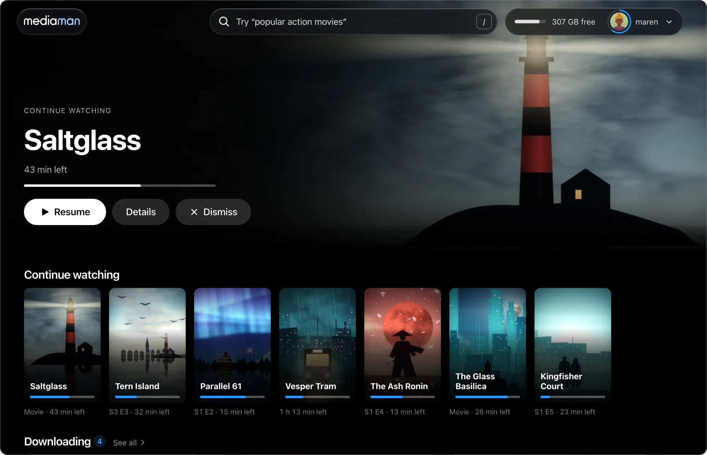
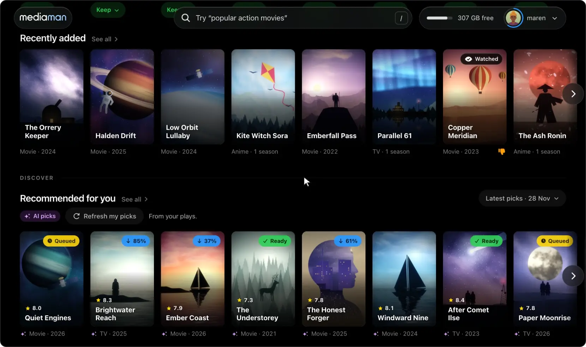
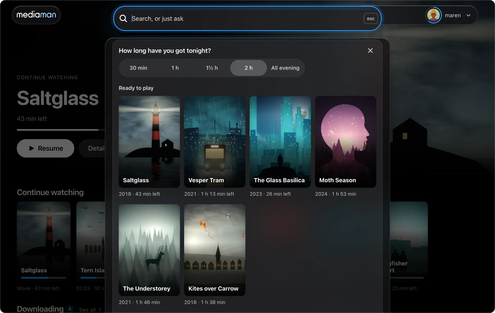
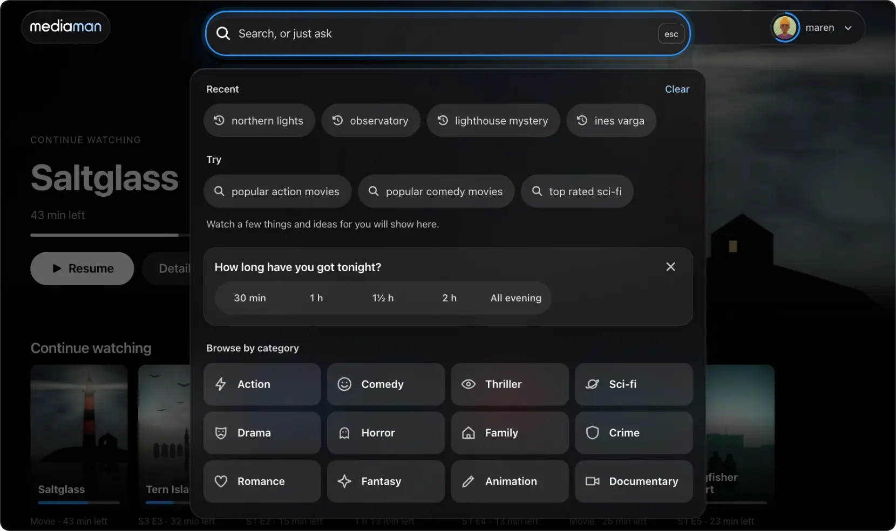
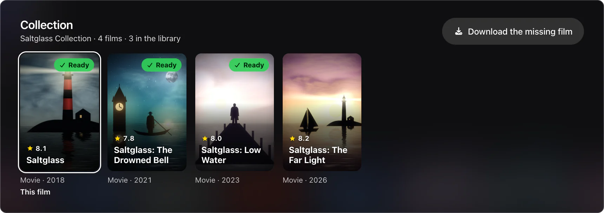
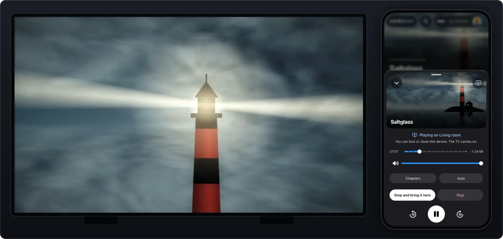
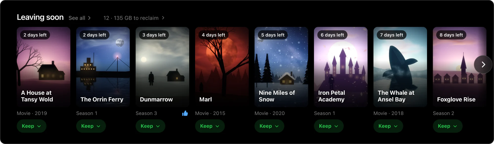
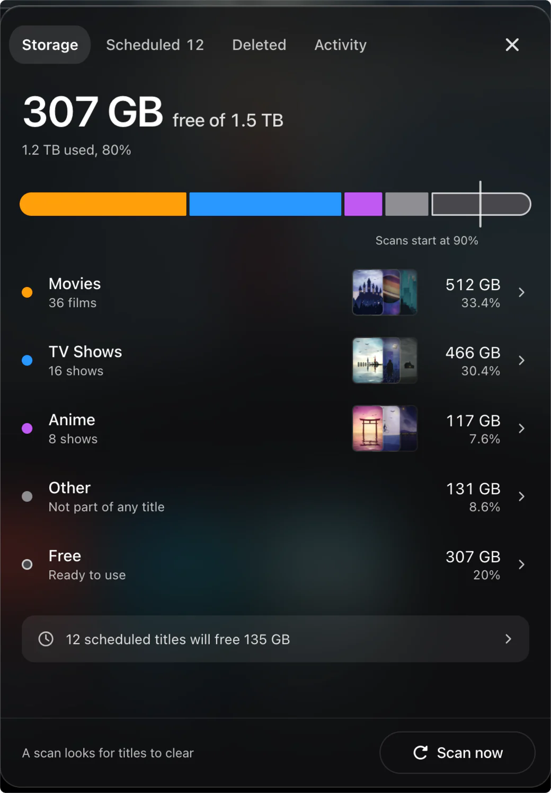
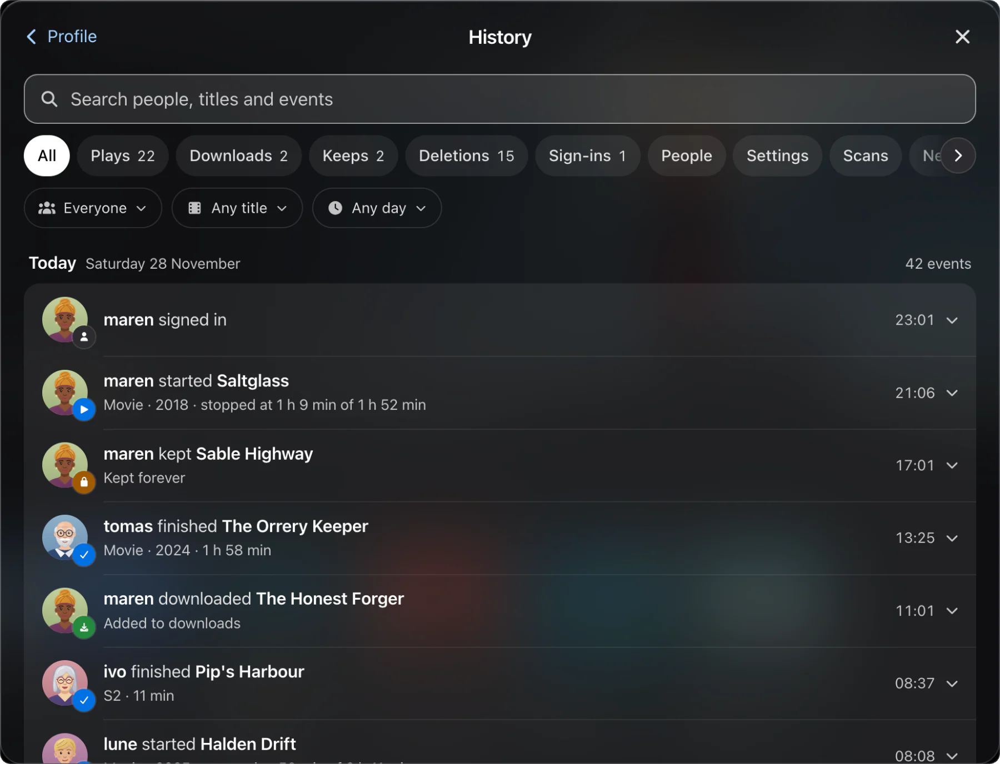

# mediaman

mediaman is a home for a Plex library. Watch your films and shows in the browser, find what to watch next, and ask for what is missing. When the disks fill up, it lists what nobody has watched and clears it away, unless somebody keeps it.



## Watch

Rest the pointer on a poster and it opens into a preview with the trailer. Everyone has their own place in every title, kept in mediaman and never written to Plex.

<picture>
  <source media="(prefers-reduced-motion: reduce)" srcset="docs/images/preview-still.webp">
  
</picture>

## Play

Skip the intro, jump from chapter to chapter, or run along the bar to see where you are going. The film comes through mediaman, so the browser never talks to Plex.

<picture>
  <source media="(prefers-reduced-motion: reduce)" srcset="docs/images/player-still.webp">
  
</picture>

When the credits start, it asks how it was, and the next episode is one press away.

<picture>
  <source media="(prefers-reduced-motion: reduce)" srcset="docs/images/credits-still.webp">
  
</picture>

## Find

Say how long you have tonight, and it offers what fits and you have not seen.



Or ask in your own words. What you have comes first, then what you could ask for.

<picture>
  <source media="(prefers-reduced-motion: reduce)" srcset="docs/images/ask-still.webp">
  
</picture>

## Picks and ratings

Each person gets picks of their own, each with its reason. Your ratings are yours alone to see, and the picks follow them.


## Collections

Open one film of a series to see the others, and fetch the missing ones together.



## On the TV

Open `/tv` in the TV's browser and type the code it shows into your phone. While a film plays there, the phone is the remote, and you can lock it or put it away.

<!-- To fill: how a film is sent to a TV from its page (Play on), AirPlay and Chromecast. At this point no page starts one yet. Then tv.webp may be taken again from that button on. -->

<picture>
  <source media="(prefers-reduced-motion: reduce)" srcset="docs/images/tv-still.webp">
  
</picture>

## Storage

What nobody has watched for a while is listed as leaving, with the day it goes. Anyone can keep a title, from the page or from the weekly email.



The meter in the bar shows admins what fills the disks, what is about to go and what went. Scheduled deletion is off until you name the folders it may delete from.



## History

Who watched, asked for and kept what, and what mediaman did by itself. Admins see everyone's; everyone else sees their own.



## Profile

Choose a picture, link your Plex account, see where you are signed in, and say whether the AI may learn from what you watch.


## Run it

```bash
[ -f mediaman.env ] || echo "MEDIAMAN_SECRET_KEY=$(openssl rand -hex 32)" > mediaman.env
docker run -d --name mediaman --env-file mediaman.env -p 8282:8282 -v mediaman-data:/data -v /path/to/your/media:/media rossetv/mediaman
docker exec -it mediaman mediaman-create-user
```

Then open `http://localhost:8282`. The [install guide](docs/install.md) goes from there: another machine, https, Plex and the other services, deletion, TVs, backups and updates.

mediaman is under the [MIT licence](LICENSE). To change it, see [CONTRIBUTING.md](CONTRIBUTING.md); to report a security problem, [SECURITY.md](SECURITY.md).
