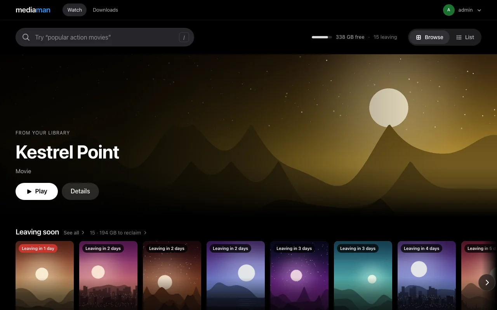
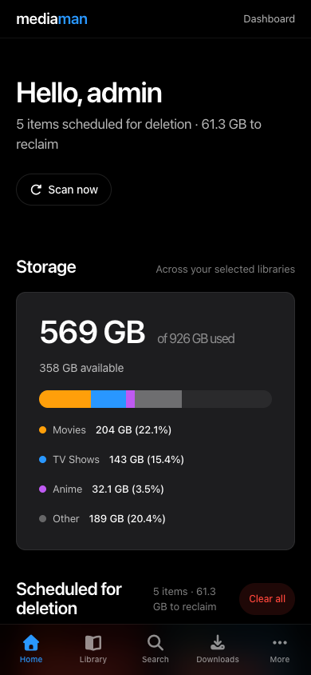
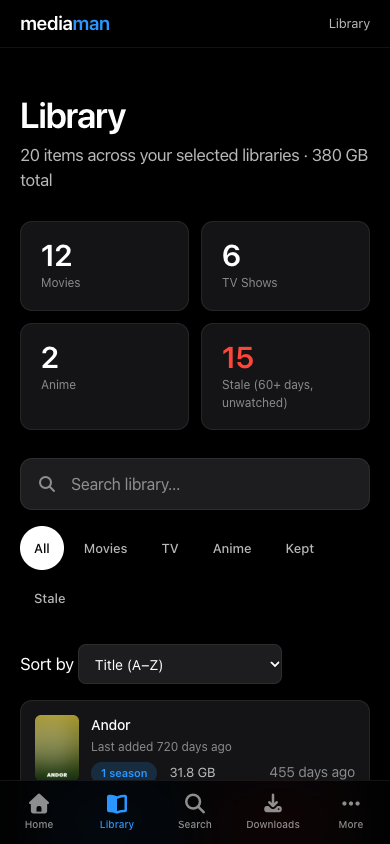
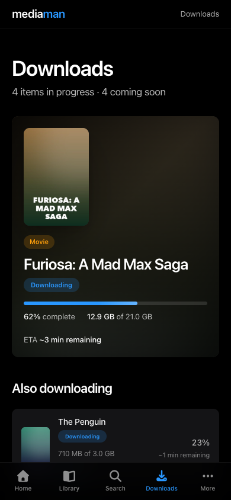
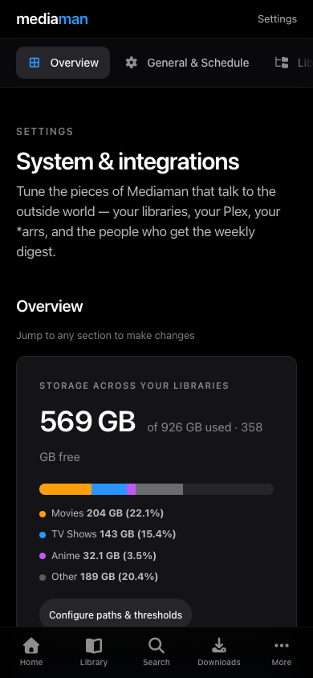

# mediaman

[](https://github.com/rossetv/mediaman/actions/workflows/ci.yml)
[](https://hub.docker.com/r/rossetv/mediaman)

mediaman keeps a self-hosted Plex library from filling up. It queues old, unwatched items for deletion, emails a newsletter where readers can keep them, and drives Sonarr, Radarr and NZBGet from a web UI.

<picture>
  <source media="(prefers-reduced-motion: reduce)" srcset="docs/images/screens-still.png">
  
</picture>


## Run it

```bash
openssl rand -hex 32 > mediaman.key   # keep it: encrypted settings need the same key

docker run -d --name mediaman \
  -p 8282:8282 \
  -e MEDIAMAN_SECRET_KEY="$(cat mediaman.key)" \
  -v mediaman-data:/data \
  -v /path/to/your/media:/media \
  rossetv/mediaman

docker exec -it mediaman mediaman-create-user   # asks for the first admin; needs a terminal
docker exec mediaman mediaman-unlock-user admin  # after 15 failed logins; clears the 24-hour lock
```

Mount your media at the path Plex uses for it (`/media` here), writable by uid 1000.

The session cookie is always `Secure`: before you log in, use HTTPS or add `-e MEDIAMAN_FORCE_SECURE_COOKIES=false` for plain `http://`.

Open `http://<host>:8282`, log in and add your services under Settings:


Scheduled deletion stays off until you set `MEDIAMAN_DELETE_ROOTS`. Press the storage meter at the top of Watch, then Scan now, and check its Scheduled tab. Then `docker rm -f mediaman` and rerun your own `docker run` with this line above the image name, naming your library folders separated by `:`. The next scan deletes everything past its grace period, with no newsletter or Keep link unless Mailgun, a Base URL readers can reach and a subscriber are set.

```bash
  -e MEDIAMAN_DELETE_ROOTS=/media/movies:/media/tv \
```

`/`, `/media`, `/data`, `/mnt`, `/srv`, `/home` and the system directories are refused as roots, and one refused root stops every scheduled deletion.

To upgrade, `docker pull rossetv/mediaman` and recreate the container the same way: same key, `/data` volume, roots and flags. mediaman refuses to start on a database last opened by a build from before 13 May 2026; the error names the image, or two images in order, to start once to upgrade it (amd64 only).

`/healthz` answers 200 while the process runs; `/readyz` answers 503 until the scheduler starts, or if the key does not match the database.

## On a phone

<p>
  
  
  
  
</p>

## Watch

Watch is a Netflix-style player for the Plex libraries mediaman scans. Plex converts the video and mediaman passes it on, so the browser never talks to Plex and the Plex token never leaves mediaman. Nothing is written to Plex: no watched marks, progress or history. Each person's progress is kept in mediaman.

Rest the pointer on a card and it grows into a preview that plays its trailer from youtube-nocookie.com. Play trailers on hover, in the preview's More menu, turns trailers off in that browser.

An admin can do everything, and has the storage meter: what fills the disks, what is scheduled for deletion and what was deleted. A viewer can watch, search and request films and series, see Downloads and Recommended, and keep a "leaving soon" item for 7, 30 or 90 days. On their Profile they can set their own email, change their own password and sign out their other devices. A viewer has no settings, library tools, history or way to cancel downloads.

Add a viewer in Settings under Team: Add user, pick Viewer, Create user; they choose their own password at first sign-in. Or from the command line:

```bash
docker exec -it mediaman mediaman-create-user --role viewer   # --role viewer|admin, default admin
```

A reverse proxy or CDN in front of mediaman must not buffer or cache the video. mediaman sends `Cache-Control: no-store, no-transform` and `X-Accel-Buffering: no` on stream responses; with nginx, also turn buffering off and allow long timeouts:

```nginx
location /api/watch/stream/ {
    proxy_pass http://mediaman:8282;
    proxy_buffering off;
    proxy_read_timeout 1h;
    proxy_send_timeout 1h;
}
```

Limits: iPhone and iPad need iOS 17.1 or later. There is no audio or subtitle choice: Plex's saved choice per item is used, and a selected subtitle is burned in. Quality is Best (1080p), Medium (720p) or Low (480p).

## Environment

| Variable | Default | What it does |
|---|---|---|
| `MEDIAMAN_SECRET_KEY` | required | 64+ hex characters or 43+ URL-safe base64; a weak key stops startup |
| `MEDIAMAN_DELETE_ROOTS` | unset: no scheduled deletion | Library folders scheduled deletion may delete from, as seen inside the container, separated by `:` |
| `MEDIAMAN_FORCE_SECURE_COOKIES` | unset: always `Secure` | `false` allows login over plain HTTP and also turns HSTS off |

[`.env.example`](.env.example) describes the rest, with defaults: port, data folder, reverse proxies, allowed hosts, HSTS and other rarely needed settings.

## Development

Python 3.12; see [CONTRIBUTING.md](CONTRIBUTING.md).

```bash
python3.12 -m venv .venv && source .venv/bin/activate
pip install -e ".[dev]" "bandit[toml]" pip-audit
make check

mkdir -p data
[ -f mediaman.key ] || openssl rand -hex 32 > mediaman.key   # reuse one key
export MEDIAMAN_SECRET_KEY="$(cat mediaman.key)" MEDIAMAN_DATA_DIR=./data MEDIAMAN_FORCE_SECURE_COOKIES=false
mediaman-create-user   # once
mediaman               # serves http://127.0.0.1:8282
```

Report vulnerabilities as [SECURITY.md](SECURITY.md) says. MIT licence ([LICENSE](LICENSE)).
