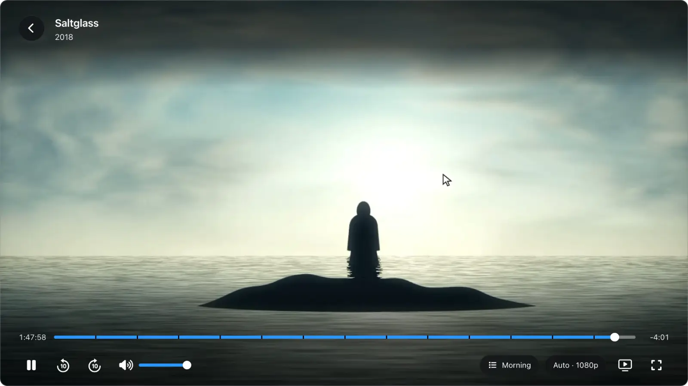
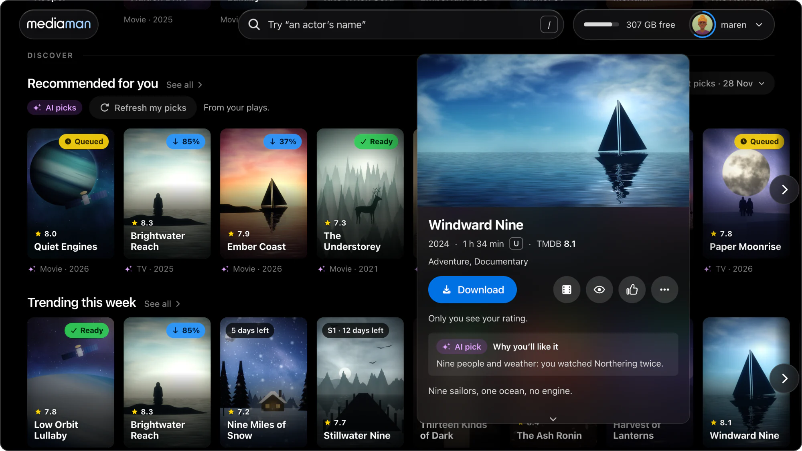
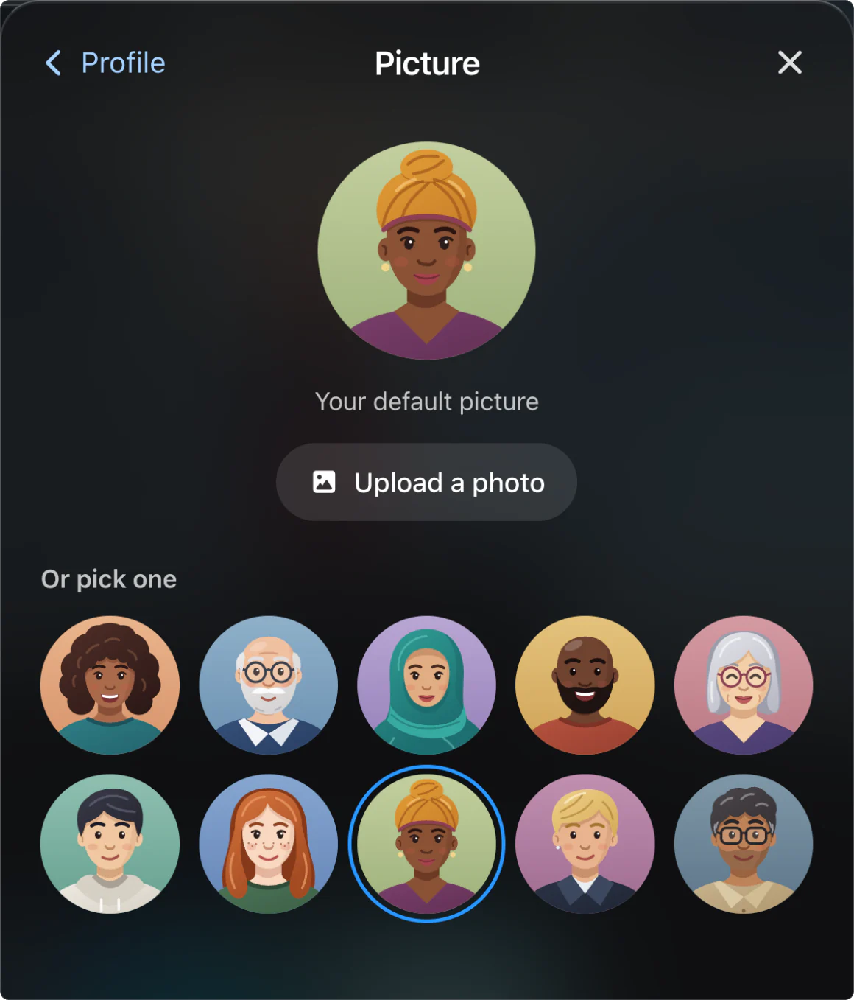

# mediaman

mediaman is a home for a Plex library. Watch your films and shows in the browser, find what to watch next, and ask for what is missing. When the disks fill up, it lists what nobody has watched and clears it away, unless somebody keeps it.


## Watch

Rest the pointer on a poster and it opens into a preview with the trailer. Everyone has their own place in every title, kept in mediaman and never written to Plex.

<picture>
  <source media="(prefers-reduced-motion: reduce)" srcset="docs/images/preview-still.webp">
  
</picture>

## Play

Skip the intro, jump from chapter to chapter, or run along the bar to see where you are going. The film comes through mediaman, so the browser never talks to Plex.

<picture>
  <source media="(prefers-reduced-motion: reduce)" srcset="docs/images/player-still.webp">
  
</picture>

When the credits start, it asks how it was, and the next episode is one press away.

<picture>
  <source media="(prefers-reduced-motion: reduce)" srcset="docs/images/credits-still.webp">
  
</picture>

## Find

Say how long you have tonight, and it offers what fits and you have not seen.


Or ask in your own words. What you have comes first, then what you could ask for.

<picture>
  <source media="(prefers-reduced-motion: reduce)" srcset="docs/images/ask-still.webp">
  
</picture>

## Picks and ratings

Each person gets picks of their own, each with its reason. Your ratings are yours alone to see, and the picks follow them.



## Collections

Open one film of a series to see the others, and fetch the missing ones together.


## On the TV

Open `/tv` in the TV's browser and type the code it shows into your phone. That TV is then yours: press Play on, on a film's page or in the player, and choose it. While that TV plays, the phone is its remote, and you can lock it or put it away.

Play on also lists AirPlay and Chromecast, which need no pairing:

- AirPlay: Safari on an iPhone, iPad or Mac, and a TV with AirPlay, such as an Apple TV. The player must stay open: leaving it stops the film.
- Chromecast: Chrome, or a browser built on it, on a computer or an Android device, mediaman opened over https, and a TV with Chromecast or Google Cast. It is off until an admin turns on Allow Chromecast in Settings, under TVs & Casting, since it loads Google's Cast script into mediaman's pages. The [install guide](docs/install.md#chromecast) says what that lets in.

Either way the TV must be able to open mediaman's address. TVs too old for a browser are added by an admin, see [TVs](docs/install.md#tvs).

<picture>
  <source media="(prefers-reduced-motion: reduce)" srcset="docs/images/tv-still.webp">
  
</picture>

## Storage

What nobody has watched for a while is listed as leaving, with the day it goes. Anyone can keep a title, from the page or from the weekly email.


The meter in the bar shows admins what fills the disks, what is about to go and what went. Scheduled deletion is off until you name the folders it may delete from.


## History

Admins see who watched, asked for and kept what, and what mediaman deleted and scanned. Everyone else sees only what they did themselves.


## Profile

Choose a picture, change your own email and password, link your Plex account (what you play in Plex apps then shapes your picks), see where you are signed in and sign out your other devices, rename or unpair your TVs, and say whether the AI may use your searches, ratings and requests and how your plays went.



## Run it

In a new folder, make a `docker-compose.yml`, with your own folder in place of `/path/to/your/media`, mounted at the path Plex uses for it:

```yaml
services:
  mediaman:
    image: rossetv/mediaman
    container_name: mediaman
    restart: unless-stopped
    ports:
      - "8282:8282"
    environment:
      MEDIAMAN_SECRET_KEY: ${MEDIAMAN_SECRET_KEY:?run the line that makes .env}
    volumes:
      - mediaman-data:/data
      - /path/to/your/media:/media

volumes:
  mediaman-data:
    name: mediaman-data
```

Then, in that folder, make the key, start [`rossetv/mediaman`](https://hub.docker.com/r/rossetv/mediaman) and create the first admin:

```bash
[ -f .env ] || (umask 077 && echo "MEDIAMAN_SECRET_KEY=$(openssl rand -hex 32)" > .env)
docker compose up -d
docker compose exec mediaman mediaman-create-user
```

Keep `.env`: your settings cannot be read without its key. Open `http://localhost:8282` in Chrome or Firefox; for Safari or another machine, see [Sign in](docs/install.md#sign-in). Then [connect Plex and the rest](docs/install.md#connect-your-services). The guide also covers https, deletion, TVs, backups and updates, and [moving from `docker run`](docs/install.md#moving-from-docker-run).

mediaman is under the [MIT licence](LICENSE). To change it, see [CONTRIBUTING.md](CONTRIBUTING.md); to report a security problem, [SECURITY.md](SECURITY.md).
