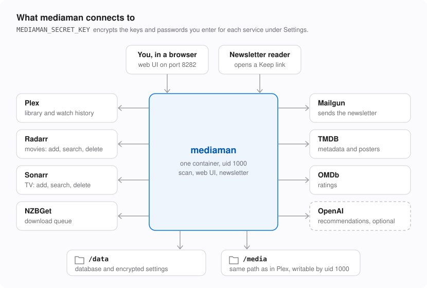

# Installing mediaman

- [What you need](#what-you-need)
- [Start it](#start-it)
- [Connect your services](#connect-your-services)
- [People](#people)
- [Https and a reverse proxy](#https-and-a-reverse-proxy)
- [Deletion](#deletion)
- [TVs](#tvs)
- [The AI, and what it is sent](#the-ai-and-what-it-is-sent)
- [Backup, update, roll back](#backup-update-roll-back)
- [Environment](#environment)
- [Limits](#limits)
- [When something is wrong](#when-something-is-wrong)

## What you need

Docker with Compose on an amd64 or arm64 machine, and a Plex Media Server that mediaman can reach, with its token. Everything else is optional:



## Start it

Make a folder for it, and in it a `docker-compose.yml`:

```yaml
services:
  mediaman:
    image: rossetv/mediaman
    container_name: mediaman
    restart: unless-stopped
    ports:
      - "8282:8282"
    environment:
      MEDIAMAN_SECRET_KEY: ${MEDIAMAN_SECRET_KEY:?run the line that makes .env}
      # Only to sign in over plain http at home; see Https below.
      # MEDIAMAN_FORCE_SECURE_COOKIES: "false"
    volumes:
      - mediaman-data:/data
      - /path/to/your/media:/media

volumes:
  mediaman-data:
    name: mediaman-data
```

Put your own folder in place of `/path/to/your/media`, and mount it at the path Plex uses for it: where Plex's libraries are under `/mnt/films`, write `/mnt/films:/mnt/films`.

Then make the key, start mediaman and create the first admin:

```bash
[ -f .env ] || echo "MEDIAMAN_SECRET_KEY=$(openssl rand -hex 32)" > .env
docker compose up -d
docker compose exec mediaman mediaman-create-user
```

Keep `.env` safe. The key encrypts the tokens and passwords you enter in Settings, and without it they cannot be read. The password needs 12 characters or more.

Open `http://localhost:8282` and sign in. From another machine use https, or uncomment `MEDIAMAN_FORCE_SECURE_COOKIES` and run `docker compose up -d` again: the session cookie is `Secure`, so over plain http you can sign in on `localhost` alone.

## Connect your services

In Settings, under Integrations, fill in a service, save, and press Test.

| Service | You enter | It gives you |
|---|---|---|
| Plex | URL, token | The library, the video and what was watched. Needed. |
| TMDB | API Read Token | Search past your library, trending and popular rows, title pages, collections |
| Radarr, Sonarr | URL, API key | Asking for films and shows, and deleting them by hand |
| NZBGet | URL, user, password | How far a download has got |
| OpenAI | API key | Picks, and asking in your own words |
| OMDb | API key | Ratings |
| Mailgun | domain, API key, from address | The weekly email and download alerts |

URLs are as the container sees them: `http://plex:32400` for a container on the same Docker network, or the machine's own address. Plex's help explains [how to find a token](https://support.plex.tv/articles/204059436-finding-an-authentication-token-x-plex-token/).

Under Libraries & Paths choose the Plex libraries mediaman reads, and give each the path Plex has for it. Then press Sync now under General & Schedule, and they appear on Watch.

Also under General & Schedule, Base URL is the address people open mediaman at. The links in emails and the TV page are made from it.

## People

In Settings, under Users & Access, press Add user. New people choose their own password when they first sign in.

A viewer can watch, search, ask for films and shows, see downloads and picks, and keep a title that is leaving for 7, 30 or 90 days. Their History shows what they did themselves. An admin can do everything: settings, storage, keeping for good, deleting, cancelling downloads, and everyone's History.

From the command line:

```bash
docker compose exec mediaman mediaman-create-user --role viewer   # or admin, the default
docker compose exec mediaman mediaman-unlock-user maren           # after too many wrong passwords
```

Fifteen wrong passwords in a row from one address lock that name there for 24 hours; the second line lifts that.

## Https and a reverse proxy

Give the proxy's address to mediaman, so it knows who is really asking, and turn HSTS on once every request is https:

```yaml
      MEDIAMAN_TRUSTED_PROXIES: 172.18.0.5
      # MEDIAMAN_HSTS_ENABLED: "true"
```

The proxy, or a CDN in front of it, must not buffer or cache the video. mediaman sends `Cache-Control: no-store, no-transform` and `X-Accel-Buffering: no` with it. In nginx, inside your `server` block:

```nginx
location / {
    proxy_pass http://mediaman:8282;
    proxy_set_header Host $http_host;
    proxy_set_header X-Forwarded-For $proxy_add_x_forwarded_for;
    proxy_set_header X-Forwarded-Proto $scheme;
}

location ~ ^/api/(watch/stream|cast)/ {
    proxy_pass http://mediaman:8282;
    proxy_set_header Host $http_host;
    proxy_set_header X-Forwarded-For $proxy_add_x_forwarded_for;
    proxy_set_header X-Forwarded-Proto $scheme;
    proxy_buffering off;
    proxy_read_timeout 1h;
    proxy_send_timeout 1h;
    access_log off;
}
```

`access_log off` keeps out of the proxy's log the addresses TVs read their streams at. Those play without signing in, for up to 6 hours, so turn the log off for `/api/cast/` in any other proxy too.

## Deletion

Scheduled deletion is off until you name the folders it may delete from.


What counts as unwatched, and how long a title then has, is under Cleanup Rules. To see what would go before anything does, press the storage meter on Watch, then Scan now, and look at its Scheduled tab.

To turn it on, add your library folders as the container sees them, separated by `:`, and start mediaman again with `docker compose up -d`. The media mount must be writable by uid 1000.

```yaml
      MEDIAMAN_DELETE_ROOTS: /media/movies:/media/tv
```

The next scan then deletes everything past its grace period, whether or not an email went out about it. Emails need Mailgun, a Base URL readers can reach and a subscriber, added under Newsletter.

`/`, `/media`, `/data`, `/mnt`, `/srv`, `/home` and the system's own folders are refused as roots, and one refused root stops every scheduled deletion.

Delete, pressed by an admin, asks Radarr or Sonarr to delete the files, and does not look at the roots.

## TVs

Open `/tv` at mediaman's address in the TV's browser, for example `https://mediaman.example.com/tv`, and enter the code it shows at `/pair`, on a phone or computer where you are signed in. The TV is then yours, and needs no password. Your TVs are on your Profile, where you can rename and unpair them.

Older TVs, without a browser that can do this, are added by an admin with their address, in Settings under TVs & Casting:

1. Turn on Allow older TVs.
2. Set Address TVs use to one that works on your home network, such as `http://192.168.1.20:8282`. Most of these TVs cannot use https: for them turn on Plain http for older TVs as well. Others on your network can then see what those TVs fetch.
3. Press Add an older TV. It is shown a test picture first.

For these, mediaman must be in a container network of its own, as it is above. With `network_mode: host`, macvlan on the home network or no container, it refuses every TV on that network. Where `MEDIAMAN_ALLOWED_HOSTS` is set, it must hold the host of that address too.

## The AI, and what it is sent

With an OpenAI key, these go to OpenAI, never with a name:

- for picks: the titles each person played, the picks they had before, and the Plex stars of the server's owner. AI recommendations, under General & Schedule, turns this off;
- unless a person turns off Use my history on their Profile: their searches, ratings, requests and how their plays went, for their picks and for the suggestions and answers in search;
- when somebody asks the AI in search: the question, whatever their switch says.

Each person may ask 20 questions a day, and everyone together makes 100 calls. Both are under OpenAI in Settings, and 0 turns asking off.

Plex gets no watched marks, progress or history from mediaman. Trailers play from youtube-nocookie.com; Play trailers on hover, in a preview's More menu, turns them off in that browser.

## Backup, update, roll back

Everything is in the `mediaman-data` volume and in `.env`. Back up both, with mediaman stopped:

```bash
docker compose stop
docker run --rm -u 0 -v mediaman-data:/data -v "$PWD":/backup rossetv/mediaman tar czf /backup/mediaman-data.tgz -C /data .
docker compose start
```

To put it back, into a new volume or an old one:

```bash
docker compose down
docker run --rm -u 0 -v mediaman-data:/data -v "$PWD":/backup rossetv/mediaman sh -c 'rm -rf /data/* && tar xzf /backup/mediaman-data.tgz -C /data'
docker compose up -d
```

To update, back up, then:

```bash
docker compose pull && docker compose up -d
```

There are no version numbers: `latest` is the newest build, and each one is also tagged `sha-` and its full commit. To go back, set `image: rossetv/mediaman:sha-<commit>`, put back the backup from before the update, and run `docker compose up -d`.

mediaman does not start on a database last opened by a build from before 13 May 2026. The error names the image to start once, or the two to start in order, to bring it up to date; they are for amd64 only.

## Environment

| Variable | Default | What it does |
|---|---|---|
| `MEDIAMAN_SECRET_KEY` | required | 64 or more hex characters, or 43 or more of URL-safe base64. A weak one stops the start. |
| `MEDIAMAN_DELETE_ROOTS` | none: no scheduled deletion | Folders scheduled deletion may delete from, separated by `:` |
| `MEDIAMAN_FORCE_SECURE_COOKIES` | always `Secure` | `false` allows signing in over plain http, and turns HSTS off |
| `MEDIAMAN_TRUSTED_PROXIES` | none | Addresses of your reverse proxies, separated by commas |

[`.env.example`](../.env.example) describes the rest: port, data folder, allowed hosts, HSTS and others seldom needed. Add one under `environment:` to use it. A longer [compose file](../docker-compose.yml), with limits and a build from source, is in the repository.

## Limits

- iPhone and iPad need iOS 17.1 or later.
- In the browser there is no choice of audio or subtitles: what Plex has saved for the title is used, and a chosen subtitle is drawn into the picture.
- Quality is Automatic, Original for plain H.264 up to 1080p, or a step from 1080p down to 480p.
- mediaman runs as one process; a worker count above 1 stops the start.

## When something is wrong

`docker compose logs mediaman` says why it did not start.

| What you see | What to do |
|---|---|
| Signing in brings the sign-in page back | The cookie needs https: see [Start it](#start-it) |
| Every request is refused | `MEDIAMAN_ALLOWED_HOSTS` does not hold the name you use |
| `/readyz` answers 503 | The key is not the one of this database, or the scheduler has not started |
| Nothing is deleted | `MEDIAMAN_DELETE_ROOTS` is not set, or one of its folders is refused; the log says which |
| The video stalls behind a proxy | It buffers: see [Https](#https-and-a-reverse-proxy) |
| An older TV is refused | mediaman shares its network: see [TVs](#tvs) |

`/healthz` answers 200 while the process runs.
